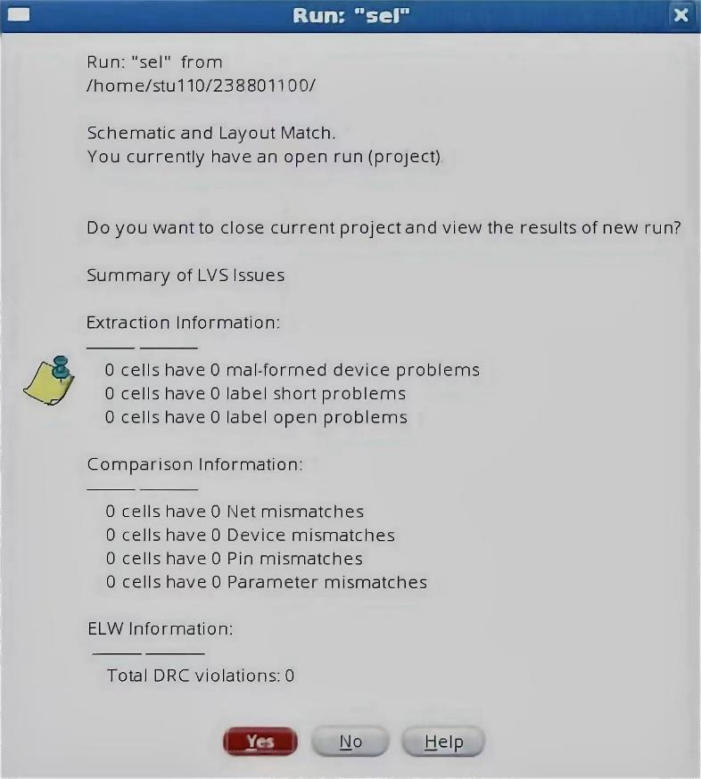

# sel: Hierarchical CMOS Cell in Cadence Virtuoso

A 2-to-1 selector built hierarchically in Cadence Virtuoso 6.1.5 from one inverter and three NAND gates, taken from schematic through symbol and layout to Assura DRC and LVS sign-off.


## Design

The top-level cell `sel` (library `lib7`) instantiates `inv` from `lib1` and three `nand` cells from `lib2`. The inverter produces the complement of `s`; two NAND gates gate the data inputs with `s̄` and `s`; the third NAND combines them:

```
y = NAND( NAND(a, s̄), NAND(b, s) ) = s̄·a + s·b
```

| `s` | `y` |
|---|---|
| 0 | `a` |
| 1 | `b` |

| Pin | Direction |
|---|---|
| `a`, `b`, `s` | input |
| `y` | output |
| `vdd`, `gnd` | inputOutput |


The symbol is generated from the schematic with `a b s` on the left, `y` on the right, `vdd` on top and `gnd` on the bottom.


## Layout

The layout instantiates the `inv` and `nand` layout views. Routing uses Poly for gate connections and short local runs, Metal1 for most signal and power nets, and Metal2 where extra tracks are needed. Contacts are made with `M1_PO` (Poly to Metal1) and `M1_M2` (Metal1 to Metal2) vias.

## Verification

| Check | Tool | Result |
|---|---|---|
| DRC | Assura | No DRC errors found |
| LVS | Assura | Schematic and layout match: 0 net, device, pin and parameter mismatches; 0 malformed-device, label-short and label-open problems |

| DRC | LVS |
|---|---|
|  |  |

## Tools

| | |
|---|---|
| Design environment | Cadence Virtuoso 6.1.5 (Schematics L, Layout L) |
| Physical verification | Cadence Assura (DRC, LVS) |
| Technology | Cadence generic PDK (gpdk) |

## Documentation

[`docs/walkthrough.md`](docs/walkthrough.md) documents every step with the corresponding screenshots: library setup, schematic, symbol, layout, DRC and LVS.

The repository contains documentation and screenshots only. The Virtuoso library databases (`lib1`, `lib2`, `lib7`) are not included.

## License

[MIT](LICENSE)
