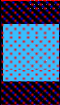
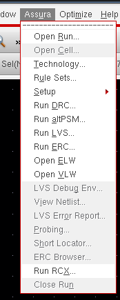
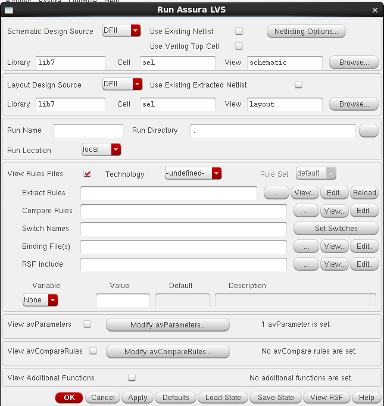

# Walkthrough

Design flow for cell `sel` in library `lib7`, Cadence Virtuoso 6.1.5.

## 1. Library setup

In the CIW (Command Interpreter Window), choose **File → New → Library**, name the library `lib7`, select *Attach to an existing technology library*, and pick the PDK technology library.

## 2. Schematic

### 2.1 Create the cellview

**File → New → Cellview** with library `lib7`, cell `sel`, view `schematic`, opened with *Schematics L*.

### 2.2 Place the instances

Press `I` to open Add Instance and place the following symbols.

| Qty | Cell | Library | View |
|---|---|---|---|
| 1 | `inv` | `lib1` | `symbol` |
| 3 | `nand` | `lib2` | `symbol` |

### 2.3 Wire the circuit

Press `W` to open Add Wire and connect the gates.

### 2.4 Add pins

Press `P` to open Add Pin.

| Pins | Direction | Usage | Signal type |
|---|---|---|---|
| `a b s` | input | schematic | signal |
| `vdd gnd` | inputOutput | schematic | power |
| `y` | output | schematic | signal |

### 2.5 Check and save

The Navigator reports 4 instances, 9 nets and 6 pins.

## 3. Symbol

Choose **Create → Cellview → From Cellview** and set the pin placement as follows.

| Side | Pins |
|---|---|
| Left | `a b s` |
| Right | `y` |
| Top | `vdd` |
| Bottom | `gnd` |

## 4. Layout

### 4.1 Create the cellview

**File → New → Cellview** with library `lib7`, cell `sel`, view `layout`, opened with *Layout L*.

### 4.2 Display options

Press `E` to open Display Options. Enable *Pin Names*, leave the snap modes at `anyAngle`, and set the array display levels to Start `0` and Stop `32`.

### 4.3 Place the instances

Press `I` to open Create Instance.

| Cell | Library | View |
|---|---|---|
| `inv` | `lib1` | `layout` |
| `nand` | `lib2` | `layout` |

### 4.4 Route

Metal1 carries most signal and power connections. Metal2 is used where extra tracks are needed to avoid congestion, and Poly for gate connections and short local routing.

Press `O` to open Create Via and select `M1_PO` for Poly to Metal1, or `M1_M2` for Metal1 to Metal2.

### 4.5 Finished layout

## 5. Physical verification

### 5.1 DRC

Open **Assura → Technology** and set the technology file to `/home/csu1/pdk/gpdk045_v5/assura_tech.lib`. Then run **Assura → Run DRC**, set *Technology* to `gpdk045_av`, and confirm with OK.

Result: no DRC errors found.

### 5.2 LVS

Run **Assura → Run LVS** with schematic `lib7/sel/schematic` against layout `lib7/sel/layout`, and *Technology* set to `gpdk045`.

Result: schematic and layout match, with no net, device, pin or parameter mismatches and no malformed-device, label-short or label-open problems.

