# Step-by-Step Walkthrough

Full design flow for cell `sel` in library `lib7` (Cadence Virtuoso 6.1.5). Every screenshot is taken from the original report ([`original-report/report.pdf`](original-report/report.pdf)).

> Items marked **⚠** are inconsistencies in the original report. See [KNOWN_ISSUES.md](KNOWN_ISSUES.md).

---

## 1. Library setup

**1.1 Create the library.** In the CIW (Command Interpreter Window): **File → New → Library**, name it `lib7`, choose *Attach to an existing technology library*, and select the PDK. ⚠ (The screenshot shows `gpdk090`; the report text elsewhere says `gpdk045`.)

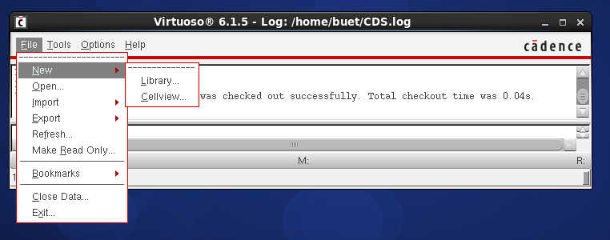
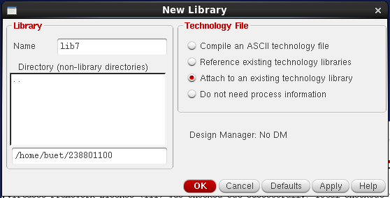
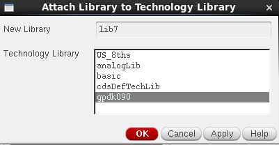

---

## 2. Schematic design

**2.1 Create the schematic cellview.** **File → New → Cellview**, library `lib7`, cell `sel`, view `schematic`, tool *Schematics L*.

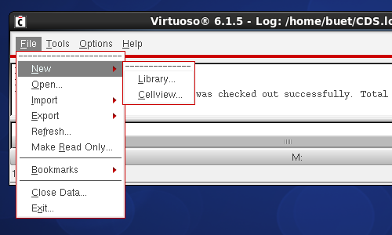
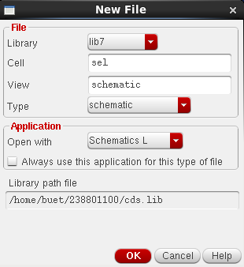

**2.2 Instantiate the symbols.** Press `I` (Add Instance) and place:

| Qty | Cell | Library | View |
|---|---|---|---|
| 1 | `inv`  | `lib1` | `symbol` |
| 3 | `nand` | `lib2` | `symbol` |

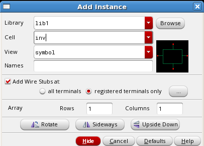
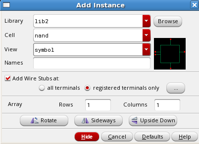
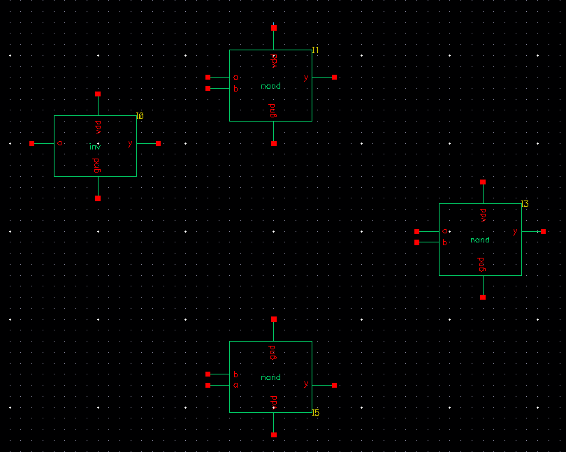

**2.3 Wire the circuit.** Press `W` (Add Wire) and connect the gates.

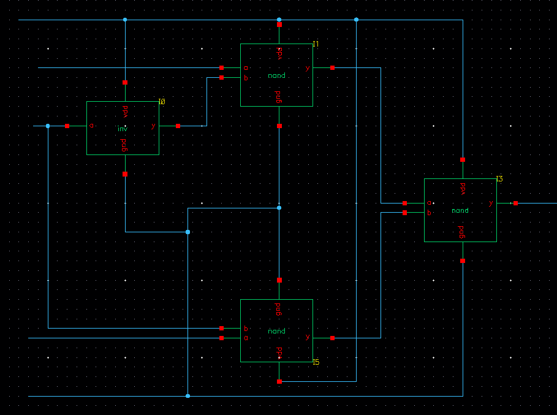

**2.4 Add pins.** Press `P` (Add Pin):

| Pin(s) | Direction | Usage / Signal type |
|---|---|---|
| `a b s` | `input` | schematic / signal |
| `vdd gnd` | `inputOutput` | schematic / power |
| `y` | `output` | schematic / signal |

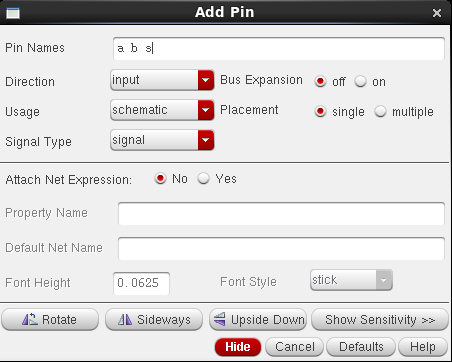
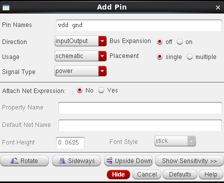
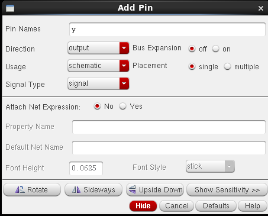

**2.5 Check and Save.** The Navigator confirms 4 instances, 9 nets, 6 pins.

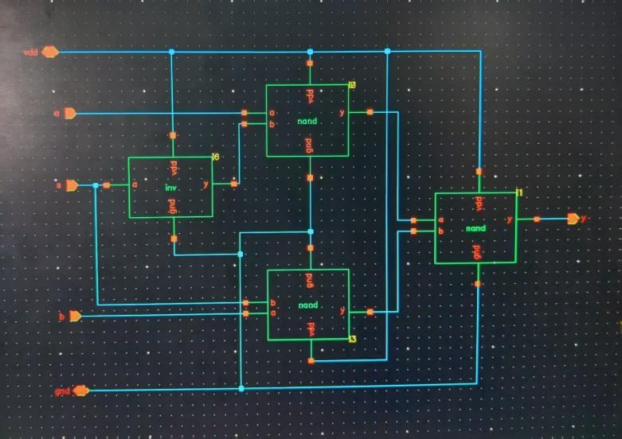
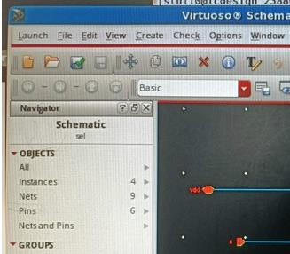

---

## 3. Symbol generation

**Create → Cellview → From Cellview**, then set the pin placement:

| Side | Pins |
|---|---|
| Left | `a b s` |
| Right | `y` |
| Top | `vdd` |
| Bottom | `gnd` |

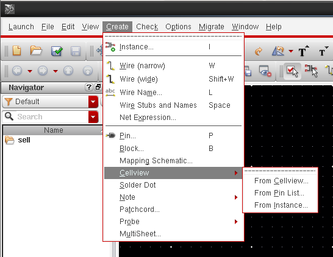
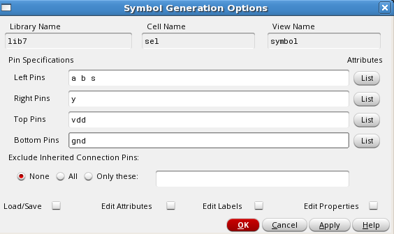
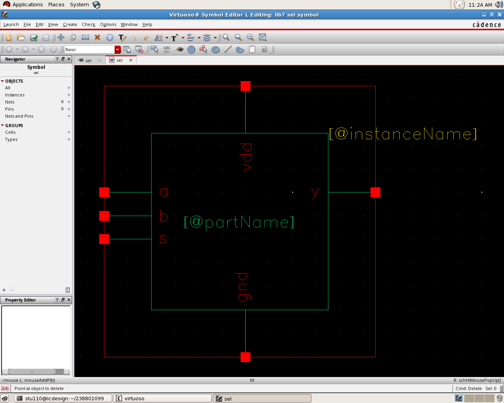

---

## 4. Layout design

**4.1 Create the layout cellview.** **File → New → Cellview**, library `lib7`, cell `sel`, view `layout`, tool *Layout L*.

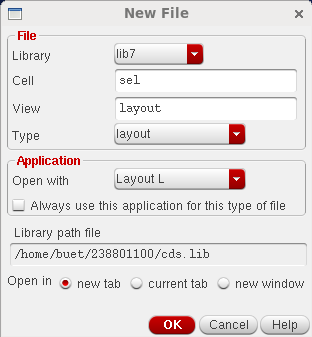
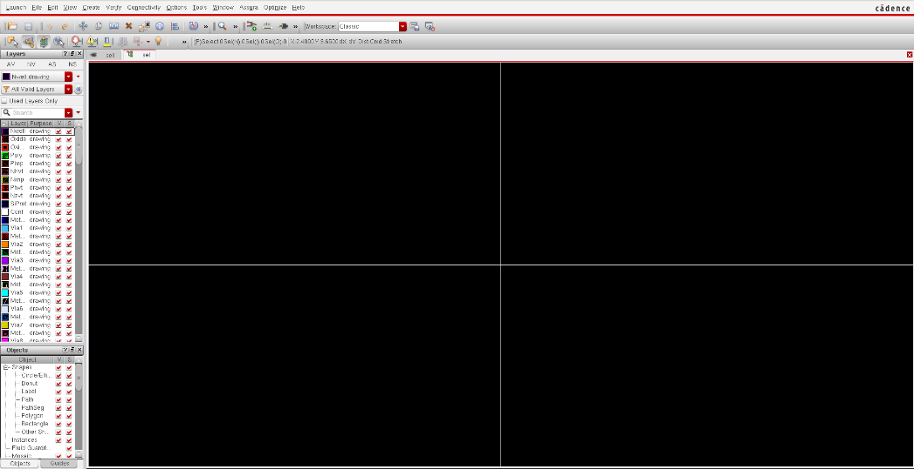

**4.2 Display options.** Press `E`. Enable *Pin Names*, keep snap modes at `anyAngle`, and set array display levels *Start* = `0`, *Stop* = `32`.

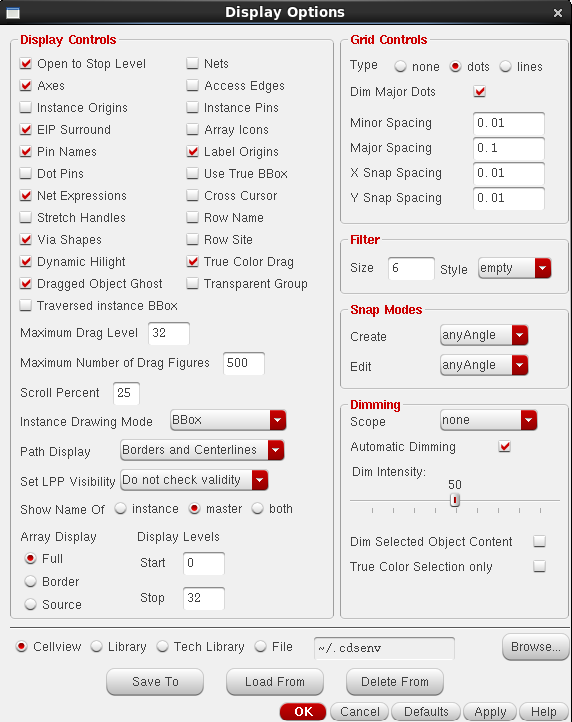

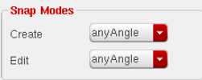
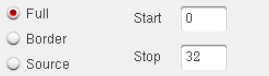

**4.3 Create instances.** Press `I`:

| Cell | Library | View |
|---|---|---|
| `inv`  | `lib1` | `layout` |
| `nand` | `lib2` | `layout` |

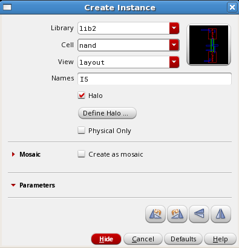

**4.4 Routing.** Metal1 is used for most signal and power routing, Metal2 where extra resources are needed to avoid congestion, and Poly for gate connections and short local routes. Press `O` (Create Via) and select `M1_PO` for Poly→Metal1 or `M1_M2` for Metal1→Metal2.

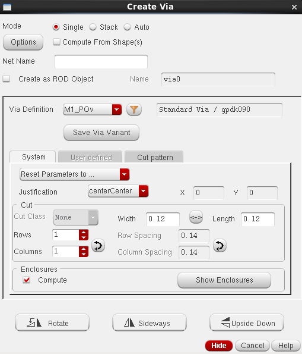
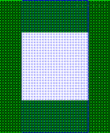

**4.5 Final layout.**

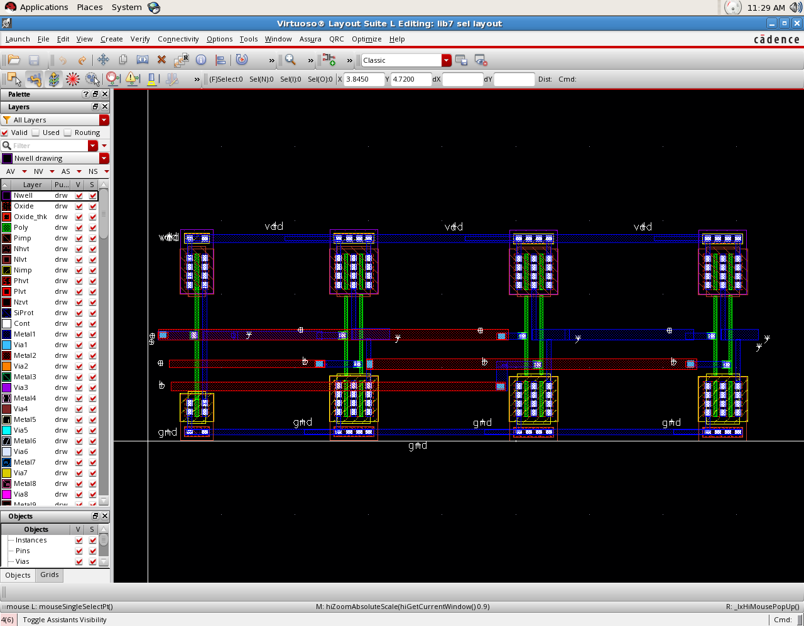

---

## 5. Physical verification (Assura)

**5.1 DRC.** **Assura → Technology**, set the technology file to `/home/csu1/pdk/gpdk045_v5/assura_tech.lib`. Then **Assura → Run DRC**, set *Technology* to `gpdk045_av`, and click OK.

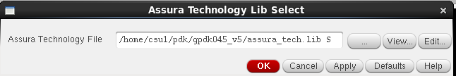

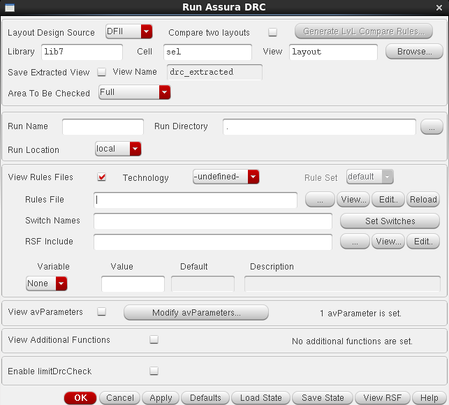

**Result: no DRC errors found.**

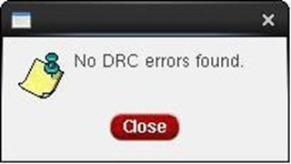

**5.2 LVS.** **Assura → Run LVS**, schematic `lib7/sel/schematic` vs layout `lib7/sel/layout`, *Technology* `gpdk045`.

**Result: schematic and layout match** — 0 net, device, pin, and parameter mismatches; 0 malformed-device, label-short, and label-open problems.

